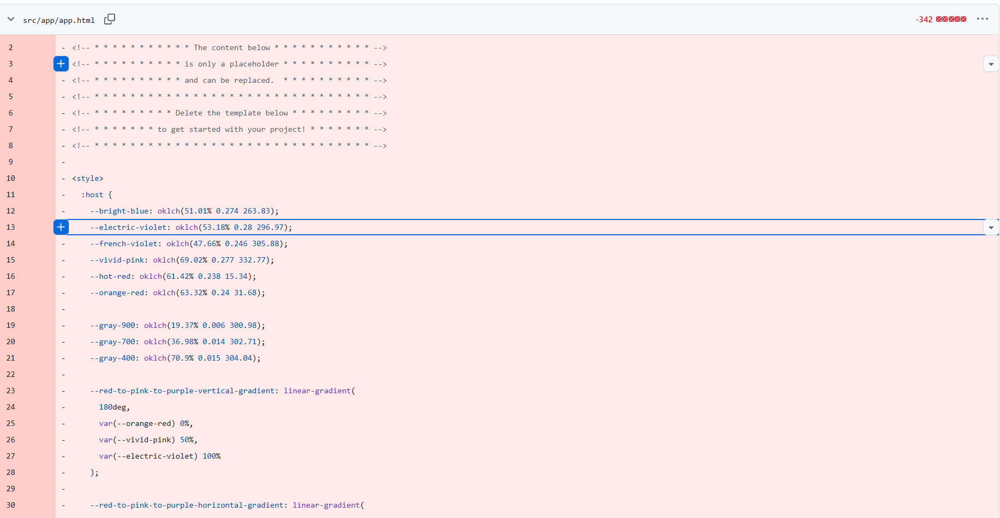

# Gestor de Tareas del Curso — Angular

**Práctica:** Desarrollo interactivo de aplicaciones web (Parte 1)  
**Asignatura:** Programación y Plataformas Web  
**Universidad:** Universidad Politécnica Salesiana  
**Framework seleccionado:** Angular  
**Integrantes:** Victoria Andrade, Isabel Ullauri, Mateo Molina y Fernando Martínez  
**Repositorio GitHub:** https://github.com/MHFERNANDO/gestor-tareas-angular  
**Aplicación desplegada:** https://gestor-tareas-angular.netlify.app

---

## Introducción

El presente proyecto tiene como finalidad investigar y aplicar los fundamentos de Angular mediante el desarrollo de una aplicación web para la gestión de tareas académicas. La práctica comprende su arquitectura, instalación, componentes, reactividad, enrutamiento, consumo de servicios REST, pruebas y despliegue.

Como resultado, se desarrolla un gestor que permite consultar, crear, editar, completar y eliminar tareas. Además, incorpora búsqueda por título y filtros por estado. La investigación se apoya en documentación oficial y se complementa con ejemplos del proyecto, dificultades resueltas y mediciones técnicas.

---

# Bloque 1. Panorama del framework Angular

## 1.1. Definición y propósito

Angular es un framework de código abierto para desarrollar aplicaciones web interactivas, mantenido por Google y su comunidad. Proporciona una estructura de trabajo y herramientas integradas para gestionar componentes, formularios, navegación y comunicación con servicios externos. Su propósito es facilitar la construcción de aplicaciones escalables y mantenibles mediante la reutilización del código y la separación de responsabilidades.

**Fuente:** [Angular — Overview](https://angular.dev/overview).

## 1.2. Origen y evolución

Angular tiene sus antecedentes en AngularJS, cuya versión 1.0 fue anunciada por Google el 14 de junio de 2012. El proyecto, en el que participó Miško Hevery, buscaba simplificar el desarrollo web mediante la extensión de HTML y la sincronización entre los datos y la interfaz.

El 22 de septiembre de 2016 se lanzó Angular 2, una renovación de la plataforma con arquitectura basada en componentes. Desde entonces, Angular ha incorporado mejoras periódicas de rendimiento y productividad. En noviembre de 2026, **Angular 22** es la versión mayor activa; el archivo `package.json` de este proyecto declara dependencias de la serie **22.2**. Las versiones 20 y 21 se encuentran en soporte a largo plazo (LTS).

**Fuentes:** [Google Developers Blog — AngularJS 1.0](https://developers.googleblog.com/en/better-web-templating-with-angularjs-10/), [Google Open Source Blog — Angular 2](https://opensource.googleblog.com/2016/09/) y [Angular — Versioning and releases](https://angular.dev/reference/releases).

## 1.3. Filosofía y principios

Angular adopta la filosofía de un **framework completo**, puesto que integra herramientas oficiales para resolver necesidades habituales del desarrollo web. Se basa en componentes reutilizables, servicios y mecanismos de reactividad que facilitan la organización de la aplicación. También promueve la estabilidad mediante versionado semántico y políticas de soporte: desde la versión 22, las versiones mayores cuentan, de manera general, con 12 meses de soporte activo y 12 meses de soporte LTS.

**Fuente:** [Angular — Overview](https://angular.dev/overview) y [Versioning and releases](https://angular.dev/reference/releases).

## 1.4. Licencia

Angular utiliza la **licencia MIT**, que permite usar, modificar y distribuir el software, incluso con fines comerciales, siempre que se conserve el aviso de derechos de autor y de licencia en las copias o partes sustanciales. El software se proporciona sin garantías.

**Fuente:** [Angular — MIT License](https://angular.dev/license).

## 1.5. Aplicación práctica

El Gestor de Tareas del Curso utiliza componentes y servicios con responsabilidades diferenciadas. `TaskListComponent` presenta el listado y los filtros; `TaskForm` permite ingresar actividades; y `TaskService` centraliza los datos y las operaciones sobre las tareas. Esta organización ejemplifica la separación entre interfaz y lógica de negocio.

**Evidencia:** `src/app/components/task-list/task-list.ts`, `src/app/components/task-form/task-form.ts` y `src/app/services/task.service.ts`.

## 1.6. Error y solución

**Error de documentación:** en una versión inicial del informe se indicó que el proyecto utilizaba Angular 18.2. **Causa:** la versión se consignó sin contrastarla con las dependencias reales. **Solución:** se revisó `package.json`, donde figuran paquetes Angular de la serie 22.2, y se contrastó su estado de soporte con la documentación oficial. Se corrigió la ficha técnica del framework.

Asimismo, durante la revisión inicial de la estructura se detectó contenido de bienvenida de Angular CLI que no formaba parte del gestor. La plantilla principal definitiva está definida en `app.ts`; el archivo `app.html` quedó reducido a una referencia al enrutador, pero no se usa desde ese componente.



---

# Bloque 2. Instalación y configuración

## 2.1. Herramientas utilizadas

- **Node.js:** entorno necesario para ejecutar las herramientas de desarrollo de Angular.
- **npm:** gestor de paquetes que instala las dependencias del proyecto.
- **Angular CLI:** herramienta oficial para crear, ejecutar, probar y compilar aplicaciones Angular.
- **Visual Studio Code:** editor utilizado para desarrollar y revisar el código.
- **Git y GitHub:** herramientas de control de versiones y colaboración.

## 2.2. Creación y ejecución del proyecto

El proyecto se generó con Angular CLI. Los comandos principales son:

```bash
ng new gestor-tareas-angular
cd gestor-tareas-angular
npm install
ng serve
```

`ng new` crea la estructura inicial; `npm install` instala las dependencias; y `ng serve` inicia el servidor de desarrollo en `http://localhost:4200/`. En el proyecto también puede ejecutarse `npm start`.

**Tiempo inicial registrado por el grupo:** 2 minutos desde la configuración hasta visualizar el proyecto en ejecución. Este dato debe respaldarse con el registro o la captura correspondiente.

**Evidencia de instalación:**


## 2.3. Estructura del proyecto

- `src/app/components/`: componentes `task-list`, `task-form`, `task-item` y `task-detail`.
- `src/app/services/`: servicio `task.service.ts` para la gestión de tareas y la comunicación HTTP.
- `src/app/app.routes.ts`: rutas del listado y del detalle.
- `src/main.ts`: arranque de la aplicación.
- `package.json`: dependencias y comandos disponibles.

## 2.4. Hola Mundo explicado

Como ejemplo básico e independiente del gestor, el siguiente componente muestra un mensaje en pantalla:

```typescript
import { Component } from '@angular/core';

@Component({
  selector: 'app-root',
  standalone: true,
  template: '<h1>¡Hola, mundo desde Angular!</h1>'
})
export class App {}
```

**Explicación del ejemplo:**

1. `import { Component }` incorpora el decorador para definir componentes.
2. `@Component` indica a Angular cómo construir este componente.
3. `selector: 'app-root'` identifica la etiqueta del componente raíz.
4. `standalone: true` declara que el componente es independiente.
5. `template` define el HTML mostrado: el título **«¡Hola, mundo desde Angular!»**.
6. `export class App {}` declara la clase TypeScript asociada.

Este código es un **ejemplo didáctico**; no sustituye la versión definitiva de `app.ts`, que utiliza `<router-outlet>` para mostrar las vistas del gestor.

**Evidencia del Hola Mundo ejecutado:**

**Resultado esperado del ejemplo didáctico:** `¡Hola, mundo desde Angular!`. El ejemplo se presenta en código; no se dispone de una captura de ejecución específica.

**Fuente:** [Angular — Tutorial de componentes](https://angular.dev/tutorials/learn-angular/1-components-in-angular).

## 2.5. Error y solución: caché de compilación

Al ejecutar `npx ng test --watch=false`, se produjo el mensaje `Angular compilation initialization failed`, junto con una referencia al archivo `.tsbuildinfo`. Se consideró una posible inconsistencia en la información temporal utilizada durante la compilación. Para recuperar el entorno se limpió la caché de Angular con `npx ng cache clean` y se volvió a ejecutar el comando de pruebas.


**Fuente:** [Angular CLI — Cache](https://angular.dev/cli/cache).

---

# Bloque 3. Componentes y plantillas

## 3.1. Fundamentos

- **Componentes:** clases TypeScript definidas con `@Component` para controlar partes de la interfaz.
- **Plantillas HTML:** describen la estructura visual y admiten expresiones de Angular.
- **Inputs y outputs:** `input()` recibe datos del componente padre y `output()` comunica eventos al padre.
- **Condicionales y listas:** `@if` muestra contenido según condiciones y `@for` recorre colecciones.
- **Ciclo de vida:** `ngOnInit()` permite ejecutar lógica cuando se inicializa un componente.

## 3.2. Implementación en el proyecto

- **`TaskListComponent`:** listado, búsqueda y filtros.
- **`TaskForm`:** formulario para registrar tareas.
- **`TaskItem`:** componente reutilizable para cada tarea y sus acciones.
- **`TaskDetail`:** información individual de una tarea.

## 3.3. Ejemplo práctico: componente reutilizable

`TaskItem` se utiliza repetidamente mediante `@for`, recibiendo datos distintos en `[tarea]` y comunicando acciones mediante eventos:

```html
@for (tarea of tareasFiltradas(); track tarea.id) {
  <li>
    <app-task-item
      [tarea]="tarea"
      (borrar)="manejarBorrado($event)"
      (toggle)="manejarToggle($event)"
      (editar)="manejarEdicion($event)">
    </app-task-item>
  </li>
}
```

En la interfaz, una misma implementación representa **al menos tres tareas con títulos y estados diferentes**.

**Evidencia:** fragmento real de `task-list.html` mostrado arriba; `TaskItem` se instancia repetidamente con distintas tareas.

## 3.4. Errores y soluciones

**Estilos CSS sin actualizarse:** algunos cambios de estilos no se reflejaban en el navegador porque los archivos modificados no se habían guardado. Se guardaron con `Ctrl + S` para que el servidor de desarrollo detectara las modificaciones y actualizara la interfaz.

**Títulos de tareas vacíos:** después de modificar componentes, algunas tarjetas mostraban casillas y botones, pero no sus títulos. Se observaron inconsistencias entre referencias de HTML y TypeScript, sin identificar una causa única. Se recuperó el último commit funcional y se reaplicaron los cambios de manera controlada.

**Botón Agregar deshabilitado:** `task-form.html` y `task-form.ts` utilizaban identificadores distintos (`titulo()` y `crearTarea()` frente a `title` y `createTask()`). Se unificaron las referencias y se utilizó `[(ngModel)]="title"` para vincular el campo con la propiedad del componente, permitiendo habilitar el botón con un título válido.

**Importación de Signals:** al usar `signal()` en `task-item.ts` sin importarlo, podía aparecer `Cannot find name 'signal'`. La importación correspondiente es `import { Component, input, output, signal } from '@angular/core';`.

**Fuente:** [Angular — Components](https://angular.dev/guide/components).

---

# Bloque 4. Estado y reactividad

## 4.1. Fundamentos

Angular ofrece **Signals** para representar información reactiva. `signal()` almacena un valor modificable; `computed()` obtiene un valor derivado cuando cambian sus dependencias. Los servicios inyectables permiten compartir ese estado entre componentes.

## 4.2. Implementación en el proyecto

`TaskService` contiene la colección de tareas y los estados de carga y error. El listado consulta las tareas y calcula cuáles mostrar según el filtro y la búsqueda. La vista de detalle utiliza el mismo servicio para identificar la tarea seleccionada.

## 4.3. Ejemplo práctico

En el servicio se define el estado compartido:

```typescript
tasks = signal<Task[]>([]);
loading = signal(false);
error = signal<string | null>(null);
```

En el componente de listado se obtiene un resultado reactivo:

```typescript
tareasFiltradas = computed(() => {
  const tareas = this.taskService.tasks();
  const estado = this.filtro();
  const busqueda = this.textoBusqueda().toLowerCase().trim();

  return tareas.filter(tarea => {
    const cumpleEstado = estado === 'todas' ||
      (estado === 'pendientes' && !tarea.completed) ||
      (estado === 'completadas' && tarea.completed);
    return cumpleEstado && tarea.title.toLowerCase().includes(busqueda);
  });
});
```

El listado y el detalle consultan `TaskService`, de modo que un cambio local en el estado puede reflejarse en ambas vistas durante la sesión.

## 4.4. Error y solución

**Pérdida de cambios al navegar:** al volver desde el detalle al listado, la recarga automática de datos podía reemplazar modificaciones locales. Se incorporó un control de carga inicial en el servicio para evitar consultas repetidas; la recarga explícita permanece disponible mediante el botón de restablecimiento. Esta medida resulta pertinente porque JSONPlaceholder no conserva los cambios de escritura.

**Fuente:** [Angular — Signals](https://angular.dev/guide/signals).

---

# Bloque 5. Enrutamiento y API REST

## 5.1. Enrutamiento

Angular Router permite navegar entre vistas de una aplicación de página única (SPA) sin recargar completamente el documento. El proyecto incluye:

| Ruta | Funcionalidad |
|---|---|
| `/` | Listado de tareas (`TaskListComponent`). |
| `/tarea/:id` | Detalle de una tarea (`TaskDetail`). |

## 5.2. Consumo de API REST

La aplicación utiliza `HttpClient` para consultar JSONPlaceholder. Emplea solicitudes **GET** para obtener tareas, **POST** para crear, **PUT** para editar o actualizar el estado y **DELETE** para eliminar. Las operaciones de escritura son simuladas: JSONPlaceholder devuelve respuestas, pero no guarda permanentemente las modificaciones.

## 5.3. Manejo de errores y estados de carga

El servicio utiliza los Signals `loading` y `error` para representar el estado de las solicitudes. Durante la carga se muestra «Cargando tareas…» y, cuando ocurre un fallo de comunicación, se presenta un mensaje informativo. En las correcciones del proyecto también se revisó el tratamiento de errores de escritura y su efecto sobre el estado local.

## 5.4. Ejemplo práctico

En `app.routes.ts` se declararon las rutas:

```typescript
export const routes: Routes = [
  { path: '', component: TaskListComponent, title: 'Lista de Tareas' },
  { path: 'tarea/:id', component: TaskDetail, title: 'Detalle de Tarea' },
  { path: '**', redirectTo: '' }
];
```

**Evidencia:** funcionamiento del listado, vista de detalle y acciones para crear, editar, completar y eliminar tareas.

**Evidencia de implementación:** `src/app/app.routes.ts`, `src/app/services/task.service.ts` y la plantilla del listado.

## 5.5. Error y solución

**Error:** `Property 'apiUrl' does not exist on type 'TaskListComponent'`. Se produjo al ubicar código de solicitudes HTTP en `task-list.ts` y tratar de acceder a propiedades que pertenecían a `TaskService`. Se retiró ese código del componente y se mantuvieron las peticiones en `task.service.ts`; el listado pasó a invocar los métodos públicos del servicio, como `this.taskService.loadTasks()`.

**Fuentes:** [Angular — Routing](https://angular.dev/guide/routing), [Angular — HTTP Client](https://angular.dev/guide/http) y [JSONPlaceholder](https://jsonplaceholder.typicode.com/).

---

# Bloque 6. Pruebas unitarias

## 6.1. Herramientas de pruebas

Las pruebas unitarias verifican comportamientos específicos de componentes y servicios. Este proyecto utiliza **Vitest** como ejecutor de pruebas y **Angular TestBed** para configurar componentes y dependencias; las solicitudes HTTP se simulan con `HttpTestingController`.

## 6.2. Pruebas implementadas

El proyecto contiene **11 pruebas definidas** en archivos `.spec.ts`. Para ejecutarlas se utiliza:

```bash
npx ng test --watch=false
```

En una ejecución intermedia se registraron **9 pruebas aprobadas y 2 fallidas** en `task.spec.ts`. Se corrigieron las pruebas afectadas; el resultado definitivo debe acreditarse mediante la captura de una nueva ejecución, posterior a las correcciones.

**Evidencia de ejecución final:**

**Resultado final:** debe consultarse en la última ejecución de `npx ng test --watch=false`. Las capturas adjuntas corresponden a fallos previos, no acreditan 11 pruebas aprobadas.

## 6.3. Ejemplos prácticos

En `task.spec.ts` se definieron pruebas que verifican:

- **Creación del servicio:** comprueba que `TaskService` pueda instanciarse correctamente.
- **Carga de tareas por GET:** intercepta la solicitud, simula la respuesta y comprueba que se actualice la lista.
- **Cambio de estado:** comprueba que una tarea pase de pendiente a completada.
- **Eliminación:** comprueba que una tarea deje de formar parte del arreglo local.

Estas pruebas, junto con las de los componentes, permiten superar el mínimo de tres casos exigido por la práctica, siempre que se confirme su ejecución satisfactoria.

## 6.4. Errores y soluciones

**Error 1. Solicitud HTTP pendiente:** al probar las operaciones de completar y eliminar se obtuvo `Expected no open requests, found 1`, porque las pruebas no respondían a las nuevas solicitudes PUT y DELETE. Se corrigieron con `httpMock.expectOne()`, la comprobación del método HTTP y `req.flush()`, para que `httpMock.verify()` no encontrara solicitudes pendientes.


**Error 2. Configuración de TestBed:** se presentó `Cannot configure the test module when the test module has already been instantiated`. Se revisó el orden de configuración de `TestBed.configureTestingModule()` y de obtención de las dependencias mediante `TestBed.inject()` dentro de `beforeEach()`. La captura identifica el error, pero por sí sola no permite determinar una causa única.


**Fuentes:** [Angular — Testing](https://angular.dev/guide/testing) y [Angular — HTTP Client Testing](https://angular.dev/guide/http/testing).

---

# Bloque 7. Ecosistema y despliegue

## 7.1. Herramientas del ecosistema

- **Angular CLI:** creación, ejecución, pruebas y compilación del proyecto.
- **Angular DevTools:** herramienta de inspección de componentes y rendimiento.
- **CSS propio:** estilos definidos a nivel global y de componentes mediante hojas CSS o estilos incorporados.

## 7.2. Compilación de producción

El proyecto utiliza el siguiente comando para generar una versión optimizada destinada al despliegue:

```bash
npm run build
```

La compilación genera los archivos de producción en `dist/gestor-tareas-angular/browser/`, según la configuración del proyecto. Este proceso prepara el JavaScript, el HTML y los estilos para su publicación.

**Evidencia técnica:** configuración de `package.json` y resultado de `npm run build`, que debe consultarse en la terminal del proyecto.

## 7.3. Despliegue

**Plataforma utilizada por el grupo:** Netlify (Netlify Drop).  
**URL declarada:** https://gestor-tareas-ups.netlify.app

El equipo documentó la publicación de la carpeta `browser/` generada por el build. Debe comprobarse el acceso público tanto a `/` como a una ruta de detalle, por ejemplo `/tarea/1`.

## 7.4. Error y solución

Al acceder directamente a una ruta como `/tarea/2`, Netlify podía responder con el error **404 Page Not Found**, porque esa dirección no corresponde a un archivo físico del servidor. Para que Angular Router gestione la navegación, se incorporó el archivo `public/_redirects` con la regla:

```text
/* /index.html 200
```

Esta regla permite que Netlify entregue `index.html` en las rutas internas de la aplicación.


**Fuentes:** [Angular — Deployment](https://angular.dev/tools/cli/deployment) y [Netlify — Redirects](https://docs.netlify.com/manage/routing/redirects/overview/).

---

# 8. Mediciones técnicas

Las mediciones siguientes fueron **reportadas por el grupo** y deben acompañarse de sus respectivas evidencias; no se recalcularon durante esta revisión del README.

| Métrica | Resultado reportado | Método de medición |
|---|---:|---|
| Tiempo de configuración inicial | 2 min | Desde la instalación hasta la primera ejecución. |
| Líneas de código (LOC) | 742 | `npx cloc src`. |
| Tamaño del build de producción | 248 KB | Tamaño de la salida de producción en `dist`. |
| Rendimiento Lighthouse | 98 / 100 | Chrome DevTools, categoría Performance, modo móvil. |
| Horas totales del grupo | Aproximadamente 12 h | Suma de los registros de los integrantes. |
| Dificultad percibida | 3 / 5 | Promedio de las valoraciones de los cuatro integrantes. |

**Evidencia de las mediciones:** los resultados corresponden a los registros informados por el grupo y deben contrastarse con las salidas de `cloc`, la compilación y Lighthouse en el equipo de desarrollo.


---

# 9. Uso responsable de inteligencia artificial

Se utilizaron herramientas de IA como apoyo para investigar, comprender conceptos, revisar código y resolver dificultades, contrastando las explicaciones técnicas con la documentación oficial y el comportamiento del proyecto.

- **NotebookLM:** consulta de fuentes oficiales, investigación sobre el origen, evolución, principios y licencia de Angular.
- **Gemini:** apoyo en la revisión del código, refactorización de Signals y análisis de fallos, según lo registrado por el grupo.
- **ChatGPT:** apoyo en la revisión de componentes y servicios, corrección de pruebas HTTP, análisis de errores y redacción técnica del informe.

## Prompts reales utilizados

1. **NotebookLM:** «Utilizando exclusivamente las fuentes oficiales cargadas, explica qué es Angular, para qué sirve, quién lo mantiene, cuál es su versión estable actual y cuáles son sus características principales. Explica los conceptos para estudiantes universitarios que están aprendiendo frameworks por primera vez. Incluye citas a las fuentes y señala cualquier información que no puedas verificar».
2. **NotebookLM:** «Con base exclusivamente en las fuentes oficiales, investiga el origen y evolución de Angular, diferenciando AngularJS de Angular moderno. Explica su filosofía como framework completo, sus principios de desarrollo y su licencia MIT. Redacta con lenguaje académico claro, incluye fechas verificadas y citas de las fuentes utilizadas. Evita repetir las características técnicas ya investigadas».
3. **Consulta de desarrollo registrada por el equipo:** «Necesito crear la función editar, ayúdame a modificar el servicio task.service.ts y el componente usando Signals».
4. **Consulta sobre despliegue registrada por el equipo:** «En Netlify a mis compañeros no les abre (da error 404), ¿no deberíamos usar GitHub Pages o está bien si seguimos esta? Ayúdame a resolver».
5. **Consulta sobre pruebas registrada por el equipo:** «Me sale este error en los tests: Cannot configure the test module when the test module has already been instantiated en task.spec.ts».

Las respuestas se utilizaron como orientación y se contrastaron con las fuentes oficiales y las pruebas disponibles, sin considerar la respuesta de la IA como evidencia suficiente por sí sola.

**Cuaderno grupal de NotebookLM:** *Estudio Angular — Gestor de Tareas*. https://notebook.google.com/notebook/54c4fccf-ff18-4e3d-8c5c-874044e36f44

---

# 10. Trabajo colaborativo

El desarrollo se organizó entre cuatro integrantes mediante Git y GitHub. Se trabajó con ramas de desarrollo, commits y revisiones de código antes de incorporar correcciones a la rama principal.

| Integrante | Responsabilidades |
|---|---|
| Mateo Molina | Liderazgo técnico, configuración de rutas, revisión de errores y apoyo en despliegue. |
| Fernando Martinez | Servicio base, comunicación con API REST y operaciones CRUD. |
| Isabel Ullauri | Componentes visuales, plantillas, estilos y manejo de estados de la interfaz. |
| Victoria Andrade | Desarrollo de la vista de detalle de tareas (`task-detail`), depuración de errores, recopilación de métricas técnicas y elaboración del README. |

**Evidencia colaborativa:** historial de commits y solicitudes de integración del repositorio grupal.

---

# 11. Conclusiones

- **Arquitectura organizada:** Angular facilitó la separación de la interfaz en componentes y la centralización de operaciones mediante servicios, lo cual favorece el mantenimiento del proyecto.
- **Reactividad:** Signals permitió actualizar el listado y los filtros cuando cambian los datos, manteniendo una relación clara entre estado e interfaz.
- **API de pruebas:** JSONPlaceholder fue útil para practicar operaciones REST, aunque sus respuestas simuladas no representan almacenamiento persistente.
- **Validación y despliegue:** las pruebas unitarias y la configuración de rutas en Netlify mostraron la importancia de verificar el comportamiento de la aplicación tanto durante el desarrollo como al publicarla.

---

# 12. Referencias

- Angular. (2026). *What is Angular?* https://angular.dev/overview
- Angular. (2026). *Versioning and releases*. https://angular.dev/reference/releases
- Angular. (2026). *License*. https://angular.dev/license
- Google Developers Blog. (2012). *Better Web Templating with AngularJS 1.0*. https://developers.googleblog.com/en/better-web-templating-with-angularjs-10/
- Google Open Source Blog. (2016). *Angular, version 2*. https://opensource.googleblog.com/2016/09/
- Angular. *Components*. https://angular.dev/guide/components
- Angular. *Signals*. https://angular.dev/guide/signals
- Angular. *Routing*. https://angular.dev/guide/routing
- Angular. *HTTP Client*. https://angular.dev/guide/http
- Angular. *HTTP Client Testing*. https://angular.dev/guide/http/testing
- Angular. *Testing*. https://angular.dev/guide/testing
- Angular. *Angular CLI*. https://angular.dev/tools/cli
- Angular. *Deployment*. https://angular.dev/tools/cli/deployment
- Angular. *Cache*. https://angular.dev/cli/cache
- Netlify. *Redirects and rewrites*. https://docs.netlify.com/manage/routing/redirects/overview/
- JSONPlaceholder. *Free fake REST API for testing and prototyping*. https://jsonplaceholder.typicode.com/
